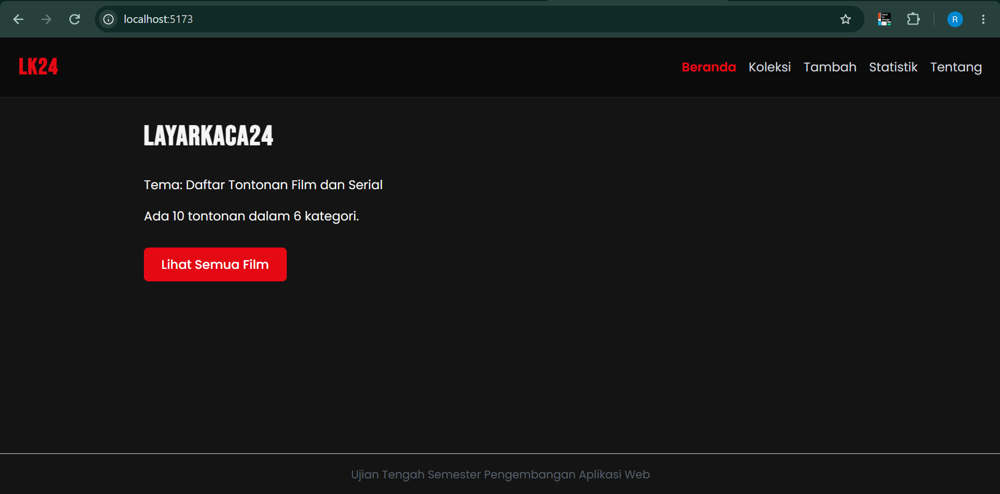
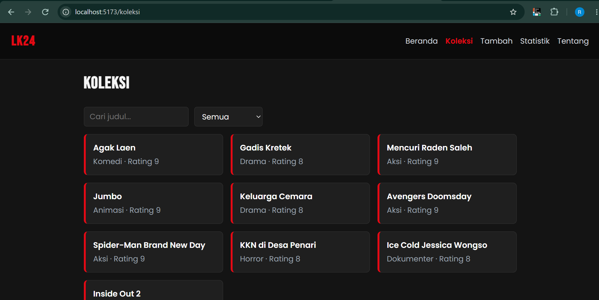
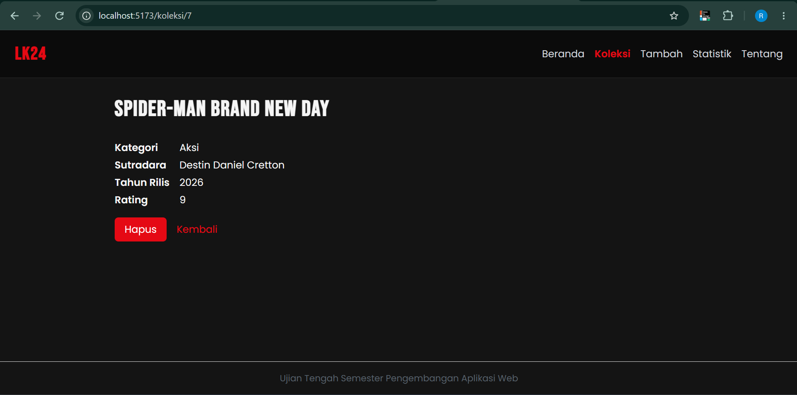
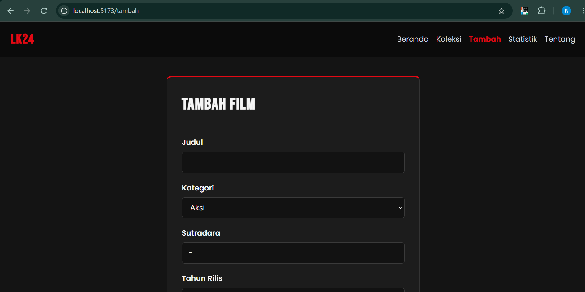
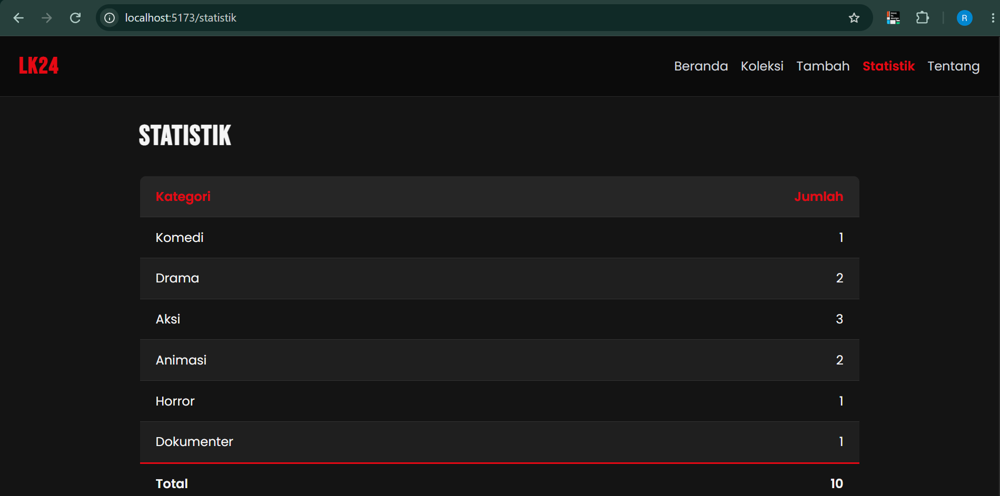
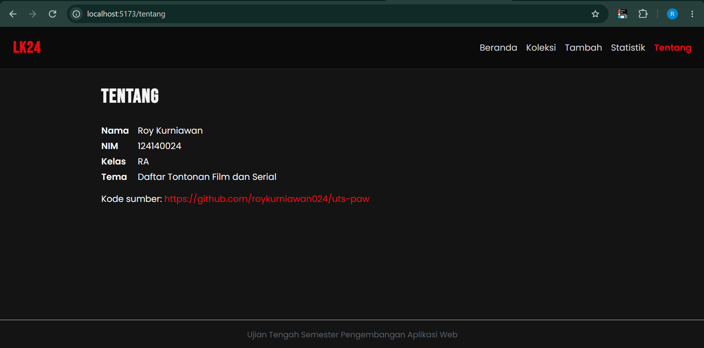
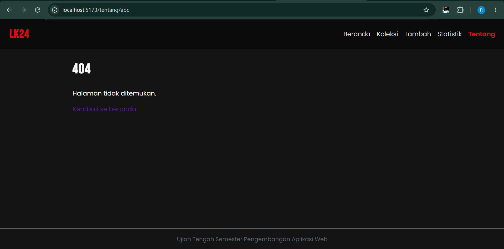

# LAYARKACA24

- Nama: Roy Kurniawan
- NIM: 124140024
- Kelas: RA
- Tema: Daftar Tontonan Film dan Serial
- Deployment: https://roykurniawan024.github.io/uts-paw/

- Tampilan Beranda

- Tampilan Koleksi

- Tampilan Detail Film

- Tampilan Tambah

- Tampilan Statistik

- Tampilan Tentang

- Tampilan 404

## Fitur

- Ringkasan jumlah film dan kategori di beranda
- Daftar koleksi film, pencarian judul, dan filter kategori
- Detail film dan hapus film
- Form tambah film baru ke localStorage
- Tabel statistik jumlah film per kategori

## Menjalankan secara lokal

- cd app
- npm install
- npm run dev

## Konsep React yang dipakai

- Komponen dan props
- useState dan useEffect
- Context API
- Custom hook (use localStorage dan useKoleksi)
- React Router
